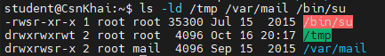

#  Report on Lab_3


## Завдання на лабороторну 3

---

### 1. Проаналізувати структуру файлу /etc/passwd та /etc/group, які поля в ній присутні, які користувачі в системі існують? Вкажіть кілька псевдокористувачів, як їх визначити?


Для аналізу структури /etc/passwd використаемо команду cat. Після виконанян команди отримаемо такий результат:

```
student@CsnKhai:/$ cat /etc/passwd
root:x:0:0:root:/root:/bin/bash
daemon:x:1:1:daemon:/usr/sbin:/usr/sbin/nologin
bin:x:2:2:bin:/bin:/usr/sbin/nologin
sys:x:3:3:sys:/dev:/usr/sbin/nologin
sync:x:4:65534:sync:/bin:/bin/sync
games:x:5:60:games:/usr/games:/usr/sbin/nologin
man:x:6:12:man:/var/cache/man:/usr/sbin/nologin
lp:x:7:7:lp:/var/spool/lpd:/usr/sbin/nologin
mail:x:8:8:mail:/var/mail:/usr/sbin/nologin
news:x:9:9:news:/var/spool/news:/usr/sbin/nologin
uucp:x:10:10:uucp:/var/spool/uucp:/usr/sbin/nologin
proxy:x:13:13:proxy:/bin:/usr/sbin/nologin
www-data:x:33:33:www-data:/var/www:/usr/sbin/nologin
backup:x:34:34:backup:/var/backups:/usr/sbin/nologin
list:x:38:38:Mailing List Manager:/var/list:/usr/sbin/nologin
irc:x:39:39:ircd:/var/run/ircd:/usr/sbin/nologin
gnats:x:41:41:Gnats Bug-Reporting System (admin):/var/lib/gnats:/usr/sbin/nologin
nobody:x:65534:65534:nobody:/nonexistent:/usr/sbin/nologin
libuuid:x:100:101::/var/lib/libuuid:
syslog:x:101:104::/home/syslog:/bin/false
messagebus:x:102:105::/var/run/dbus:/bin/false
sshd:x:103:65534::/var/run/sshd:/usr/sbin/nologin
student:x:1000:1000:Student KhAI,1,+38095,+38095:/home/student:/bin/bash

```
У кожного виведеного рядку існує по с полів відділених двокрапкою де кожне поле відповідає за значення де перше є ім'ям користувача, 2 паролем, 3 UID, 4 GID,5 коментар, 6 домашній каталог і 7 командна оболонка.
Користувачів у системі можна поділити на 3 групи адміністратор root, звичайний користувач student та системні псевдокористувачі як наприклад daemon, bin, sys та games.
Для псевдокористувачів відводятся UID від 1 до 999 туму відрізнити їх від звичайних можна за цим id.

Для аналізу структури /etc/group використовуемо ту саму команду.

```
root:x:0:
daemon:x:1:
bin:x:2:
sys:x:3:
adm:x:4:syslog,student
tty:x:5:
disk:x:6:
lp:x:7:
mail:x:8:
news:x:9:
uucp:x:10:
man:x:12:
proxy:x:13:
kmem:x:15:
dialout:x:20:
fax:x:21:
voice:x:22:
cdrom:x:24:student
floppy:x:25:
tape:x:26:
sudo:x:27:student
audio:x:29:
dip:x:30:student
www-data:x:33:
backup:x:34:
operator:x:37:
list:x:38:
irc:x:39:
src:x:40:
gnats:x:41:
shadow:x:42:
utmp:x:43:
video:x:44:
sasl:x:45:
plugdev:x:46:student
staff:x:50:
games:x:60:
users:x:100:
nogroup:x:65534:
libuuid:x:101:
netdev:x:102:
crontab:x:103:
syslog:x:104:
messagebus:x:105:
fuse:x:106:
mlocate:x:107:
ssh:x:108:
student:x:1000:
lpadmin:x:109:student
sambashare:x:110:student
girls_group:x:1001:
boys_group:x:1002:
friend:x:1003:
```

Файл /etc/group має у собі 4 групи: Назва, пароль, GID та список користувачів.


---

### 2. Які існують негласні діапазони UID? Що таке UID? Як його визначити?

Для отримання даних UID використаемо команду id.

```
uid=1000(student) gid=1000(student) groups=1000(student),4(adm),24(cdrom),27(sudo),30(dip),46(plugdev),109(lpadmin),110(sambashare)
```
Негласним діапазоном UID є діапазон від 1000 до 6000.


---

### 3. Що таке GID? Як його визначити?

Для отримання даних GID використаемо ту саму команду  команду id.

```
uid=1000(student) gid=1000(student) groups=1000(student),4(adm),24(cdrom),27(sudo),30(dip),46(plugdev),109(lpadmin),110(sambashare)
```

GID це унікальний числовий ідентифікатор, який операційна система Linux призначає кожній групі користувачів.

Іншими методами визначити GID це перешлянути його у файлі  /etc/passwd

### 4. Як визначити, хто входить до якої групи?

За допомогою цієї ж команди id можна дізнатися список усіх груп користувачів.

```
uid=1000(student) gid=1000(student) groups=1000(student),4(adm),24(cdrom),27(sudo),30(dip),46(plugdev),109(lpadmin),110(sambashare)
```

---

### 5. Які існують команди для додавання користувача до системи? Які основні параметри необхідні для створення користувача?

Щоб додати нового користувача використаемо команду sudo useradd -m -s /bin/bash danyl1 після чого для створення паролю для цього користувача використаемо команду passwd

```
student@CsnKhai:/$ sudo useradd -m -s /bin/bash danyl1
[sudo] password for student:
student@CsnKhai:/$ sudo passwd danyl1
Enter new UNIX password:
Retype new UNIX password:
passwd: password updated successfully
```
Після цього при використанні команди cat /etc/passwd там зйявится новий запис

```
student:x:1000:1000:Student KhAI,1,+38095,+38095:/home/student:/bin/bash
danyl1:x:1001:1004::/home/danyl1:/bin/bash
```
Після цього при заході до системи можна зайти з нового користувача

```
login as: danyl1
danyl1@192.168.0.185's password:
    ┌──────────────────────────────────────────────────────────────────────┐
    │                 • MobaXterm Personal Edition v26.4 •                 │
    │               (SSH client, X server and network tools)               │
    │                                                                      │
    │ ⮞ SSH session to danyl1@192.168.0.185                                │
    │   • Direct SSH      :  ✓                                             │
    │   • SSH compression :  ✗                                             │
    │   • SSH-browser     :  ✓                                             │
    │   • X11-forwarding  :  ✓  (remote display is forwarded through SSH)  │
    │                                                                      │
    │ ⮞ For more info, ctrl+click on help or visit our website.            │
    └──────────────────────────────────────────────────────────────────────┘

```


---

### 6. Як змінити ім'я (ім'я облікового запису) існуючого користувача?

Для зміни імені користувача використаемо команду sudo usermod -l danyl danyl1 після чого логін змінився на задану назву.

```
danyl@CsnKhai:~$
```

---

### 7. Що таке skell_dir? Яка його структура?

Використовуючи команду ls -la /etc/ske перглянемо цей каталог

```
student@CsnKhai:/$ ls -la /etc/skel
total 20
drwxr-xr-x  2 root root 4096 Sep 15  2015 .
drwxr-xr-x 83 root root 4096 Oct 16 15:46 ..
-rw-r--r--  1 root root  220 Apr  9  2014 .bash_logout
-rw-r--r--  1 root root 3637 Apr  9  2014 .bashrc
-rw-r--r--  1 root root  675 Apr  9  2014 .profile
```

skel_dir  — це системний каталог, який містить шаблонний набір файлів та папок. При створенні нового користувача цей каталог автоматично копіюється в новостворену директорію для ствоерння базових файлів.
До його структури належать 
.bashrc - файл конфігурації оболонки Bash для інтерактивних сесій.
.profile - файл, що виконується при вході користувача в систему та налаштовує глобальні змінні середовища.
.bash_logout - містить команди, які виконуються автоматично при виході користувача зсесії Bash.


---

### 8. Як видалити користувача із системи (включаючи його поштову скриньку)?

Для виконання цього завдання було створено новиго корисутвача Danyl2

```
student:x:1000:1000:Student KhAI,1,+38095,+38095:/home/student:/bin/bash
danyl:x:1001:1004::/home/danyl1:/bin/bash
danyl2:x:1002:1005::/home/danyl2:/bin/bash
```

Після цього за допомогою окманди ls -la /var/mail було перевірено усі існуючі пошти але через те що вона не створюєтся автоматично пошти тому там немає пошти створеного нами користувача

```
student@CsnKhai:/$ ls -la /var/mail
total 8
drwxrwsr-x  2 root mail 4096 Sep 15  2015 .
drwxr-xr-x 11 root root 4096 Sep 15  2015 ..
```

після цього за допомогою команди sudo userdel -r danyl2 було видлено користувача 

```

```
student@CsnKhai:/$ sudo userdel -r danyl2
[sudo] password for student:
userdel: danyl2 mail spool (/var/mail/danyl2) not found

```
sshd:x:103:65534::/var/run/sshd:/usr/sbin/nologin
student:x:1000:1000:Student KhAI,1,+38095,+38095:/home/student:/bin/bash
danyl:x:1001:1004::/home/danyl1:/bin/bash
student@CsnKhai:/$
```


---

### 9. Які потрібно використовувати команди та ключі для блокування та розблокування облікового запису користувача?

Для блокування корисутвача неопхідно використати команду usermod з ключем -L:

```
student@CsnKhai:/$ sudo usermod -L danyl
student@CsnKhai:/$
```

```
login as: danyl
danyl@192.168.0.185's password:
Access denied
danyl@192.168.0.185's password:
```
Після використання ключа -U доступ знову відкрився

```
login as: danyl
danyl@192.168.0.185's password:
    ┌──────────────────────────────────────────────────────────────────────┐
    │                 • MobaXterm Personal Edition v26.4 •                 │
    │               (SSH client, X server and network tools)               │
    │                                                                      │
    │ ⮞ SSH session to danyl@192.168.0.185                                 │
    │   • Direct SSH      :  ✓                                             │
    │   • SSH compression :  ✗                                             │
    │   • SSH-browser     :  ✓                                             │
    │   • X11-forwarding  :  ✓  (remote display is forwarded through SSH)  │
    │                                                                      │
    │ ⮞ For more info, ctrl+click on help or visit our website.            │
    └──────────────────────────────────────────────────────────────────────┘
```


---

### 10. Як зняти пароль користувача та надати йому безпарольний вхід для подальшої зміни пароля?

Для того щоб зняти термін дії паролю з користувача неопхідно використати passwd з  ключ -e

```
student@CsnKhai:/$ sudo passwd -e danyl
passwd: password expiry information changed.
```
 Після цього старий пароль вважався застарівлим і було неопзідно його змінити після якої новий пароль зберігся замість старого.

```
WARNING: Your password has expired.
You must change your password now and login again!
Changing password for danyl.
(current) UNIX password:
Enter new UNIX password:
Retype new UNIX password:
passwd: password updated successfully

```


---

### 11. Вивести розширений формат інформації про каталог, розповісти про інформаційні стовпці, що виводяться на термінал.

Для виведення інформації використаєто команду ls -ld /etc

```
student@CsnKhai:/$ ls -ld /etc
drwxr-xr-x 83 root root 4096 Oct 16 18:05 /etc
```
Кожен з виведених стовбців занчить наступне:

Перший рядок показуе тип об'єкта та права доступу;

Другий на кількість жорстких посилань;

Трете показує власника

Четверте групу

п'яте розмір

Шосте час останьої зміни

Сьому назву


---


### 12. Які права доступу існують і для когось (тобто описати основні ролі)? Опишіть коротко абревіатуру прав доступу.

У Лінукс існує 3 ролі а саме u - власник, g - група та о до якаї відносятся усі інші.
Абрівіатура прав доступу відсилає на те які дії дозволено виконувати з об'єктом а саме r - Read - читання, W - Write - запис, х - Execute - виконання. Якщо до чогось з цього немає доступу то замість атрибуту буде дефіс.

Цк пожна побачити на цьому зображені:

```
student@CsnKhai:~$ ls -l
total 16
drwxrwxr-x 4 student student 4096 Sep 25 17:39 data
-rw-rw-r-- 1 student student    6 Sep 24 05:31 Laba2
drwxrwxr-x 2 student student 4096 Sep 24 06:07 test
drwxrwxr-x 2 student student 4096 Sep 25 18:07 Test
```


---

### 13. Яка послідовність визначення відносин між файлом та користувачем?

Перевірка прав доступу користувача до файла (або каталогу) в Linux відбувається за суворою послідовністю згори донизу. ОС перевіряє критерії один за одним і зупиняється на першому ж збігу. Послідовність має такий вигляд:

Перевірка на суперкористувача при якій система обходить більшість перевірок та має повний доступ до будь яких файлів далі перевірка власника яка перевіряє UID користувача та власника файлу далі перевірка групи де якщо користувач власником файла, ОС перевіряє, чи збігається GID файла з основною групою  або будь-якою з додаткових груп  і перевірка інших.


---

### 14. Які команди використовуються для зміни власника файлу (каталогу) та режиму доступу до файлу? Наведіть приклади, продемонструйте на терміналі.

Для зміни власнирка та режиму доступу до фвйлу неопхідно використати команду chown

Для прикладу виикористаємо цю команду для файлу Laba2

```
-rw-rw-r-- 1 student student    6 Sep 24 05:31 Laba2
```
У наступному  прикладі  за допомогою команди chmod почергово змінили права доступу до файлу Laba2

```
student@CsnKhai:~$ ls -l Laba2
-rw-rw-r-- 1 student student 6 Sep 24 05:31 Laba2
student@CsnKhai:~$ ls -l Laba2
-rw-rw-r-- 1 student student 6 Sep 24 05:31 Laba2
student@CsnKhai:~$ chmod u+x Laba2
student@CsnKhai:~$ ls -l Laba2
-rwxrw-r-- 1 student student 6 Sep 24 05:31 Laba2
student@CsnKhai:~$ chmod u=rw,g=rw,o=r Laba2
student@CsnKhai:~$ ls -l Laba2
-rw-rw-r-- 1 student student 6 Sep 24 05:31 Laba2
```

---

### 15. Наведіть приклад восьмеричного надання прав доступу. Опишіть umask.

Для прикладу восьмеричного надання використаєм той самий файл Laba2

```
student@CsnKhai:~$ ls -l Laba2
-rw-rw-r-- 1 student student 6 Sep 24 05:31 Laba2
student@CsnKhai:~$ chmod 754 Laba2
student@CsnKhai:~$ ls -l Laba2
-rwxr-xr-- 1 student student 6 Sep 24 05:31 Laba2
```

umask — це маска в Linux, яка забороняє певні права доступу за замовчуванням під час створення нових файлів та каталогів.
Для перегляданя поточного налаштування потрібно використати команду umask для зміни ціеї маски потрібно використати разом з нею восьмеричний код

```
student@CsnKhai:~$ umask
0002
student@CsnKhai:~$ umask 077
student@CsnKhai:~$ touch test_file.txt
student@CsnKhai:~$ ls -l test_file.txt
-rw------- 1 student student 0 Oct 16 20:54 test_file.txt
```

---

### 16. Дайте визначення sticky біт і механізму заміни ідентифікатора. Наведіть приклад файлів та каталогів із даними атрибутами.

Sticky bit це спеціальний прапорець прав доступу, який використовується переважно для каталогів. Він гарантує, що видаляти або перейменовувати файли всередині каталогу може тільки власник відповідного файлу або суперкористувач , навіть якщо інші користувачі мають повні права на запис у цей каталог.

Механізм заміни ідентифікатора  дозволяє тимчасово надавати програмі або процесу привілеї власника файлу чи відповідної групи під час виконання а саме SetUID при якому програма під час запуску виконується з привілеями власника цього файлу, а не користувача та SetGID яка запускає програму з привілеями групи-власника файлу
Приклад файлів з цими атрибутами




---

### 17. Які атрибути файлу повинні бути присутніми у командному скрипті?

Для того щоб командний скрипт був успішно та безпечно виконаний у Linux, необхідна наявність кількох ключових атрибутів доступу та службових елементів, а саме право на виконання що дозволить запистити цей файл, право на читання для можливості зчитувати файл та власника файлу.


---

### 18. Опишіть коротко роботу з механізмом квот, основні конфігураційні файли, принцип роботи, основні поняття.

Квоти в Linux дозволяють обмежувати використання дискового простору та кількості файлів для окремих користувачів або груп.
Основними понятями квот є жорсткий ліміт який користувач не може перевищіти, м’який ліміт який дозволяє зробити дію з попередженям і пільговим періодом на певний час, пільговий період, обмеження на опсяг даних та кількість файлів та каталогів.

основними файлами є /etc/fstab та aquota.user або aquota.group.

Для роботи з квотами неопхідно спочатку додати опції квоти у систему, перезапустити її, створити бази даних і після запистити та налаштувати їх.
Після чого ковти можна переглянути за допомогою команди quota -s.

---

### Висновки

У ході виконання лабораторної роботи було детально досліджено та практично засвоєно механізми адміністрування користувачів, груп і прав доступу в операційній системі Linux. На практиці опрацьовано структуру системних конфігураційних файлів /etc/passwd та /etc/group, базові та розширені права доступу (включаючи восьмеричну нотацію, маску umask, а також спеціальні біти Sticky bit, SetUID та SetGID), а також команди для керування обліковими записами (useradd, usermod, userdel, passwd). Окрім цього, розібрано принцип організації дискових квот для користувачів та груп, що є критично важливим для забезпечення безпеки, розмежування привілеїв та раціонального розподілу ресурсів системи.

